<div align="center">

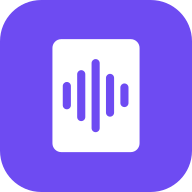

# Memoa

**Un diario intelligente: scrivi o registra i tuoi pensieri, Memoa li trascrive, li organizza e te li fa ritrovare per significato.**

[Prova l'app](https://kind-bush-0a9957b03.4.azurestaticapps.net) · [Architettura](#architettura) · [Scelte tecniche](#scelte-tecniche) · [Documentazione](#documentazione)


</div>

---

## In breve

Memoa è un side project full-stack, progettato e sviluppato da zero: una PWA per tenere un diario di note scritte, vocali o caricate da file, con trascrizione automatica, ricerca semantica multilingue e tag assegnati dall'AI.

Il progetto è nato con tre vincoli precisi, che hanno guidato tutte le scelte architetturali:

| Vincolo | Conseguenza |
|---|---|
| **~10 € al mese** di costi Azure (dev + prod) | Solo servizi serverless o a consumo, sfruttando le soglie gratuite (Azure SQL free offer, Flex Consumption, grant di Container Apps, Static Web Apps Free) |
| **GDPR**, dati solo in UE | Tutte le risorse in West Europe, Azure OpenAI in Data Zone EU, nessun dato personale nei log, nelle code o negli URL |
| **Affidabilità** di una pipeline asincrona | Architettura a eventi e code, handler idempotenti, retry e ripiego automatico per la trascrizione |

## Funzionalità

- 🎙️ **Note vocali**: registrazione dal browser o upload di file audio (fino a 30 minuti), trascritti in automatico con rilevamento della lingua (italiano o inglese).
- ✍️ **Note scritte e documenti**: testo libero oppure PDF, Markdown e TXT, da cui viene estratto il testo.
- 🔍 **Ricerca semantica**: trova le note per significato e non per parole esatte, anche tra lingue diverse (una query in inglese trova note in italiano). Disponibili anche i filtri classici.
- 🏷️ **Tag automatici**: l'utente definisce i propri tag con una descrizione e Memoa li assegna da sola alle note pertinenti, per similarità semantica. I tag si possono anche assegnare o togliere a mano.
- 📱 **Pensata per il mobile**: PWA installabile, gesture (swipe, pressione prolungata, selezione multipla), tema chiaro e scuro, APK Android (Trusted Web Activity).
- ⚙️ **Pannello di amministrazione**: parametri di sistema (soglie di similarità, timeout, feature flag) modificabili a runtime, senza nuovo deploy.

## Screenshot

<table>
<tr>
<td align="center" width="33%">
<picture>
  <source media="(prefers-color-scheme: dark)" srcset="docs/screenshots/home-dark.png">
  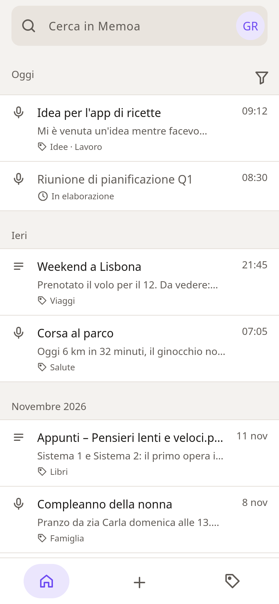
</picture>
<br><sub>Note raggruppate per giorno, con tag e stato di elaborazione</sub>
</td>
<td align="center" width="33%">
<picture>
  <source media="(prefers-color-scheme: dark)" srcset="docs/screenshots/add-dark.png">
  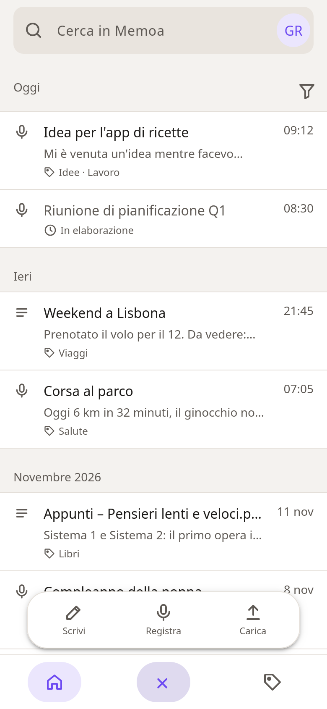
</picture>
<br><sub>Tre modi per aggiungere una nota</sub>
</td>
<td align="center" width="33%">
<picture>
  <source media="(prefers-color-scheme: dark)" srcset="docs/screenshots/search-dark.png">
  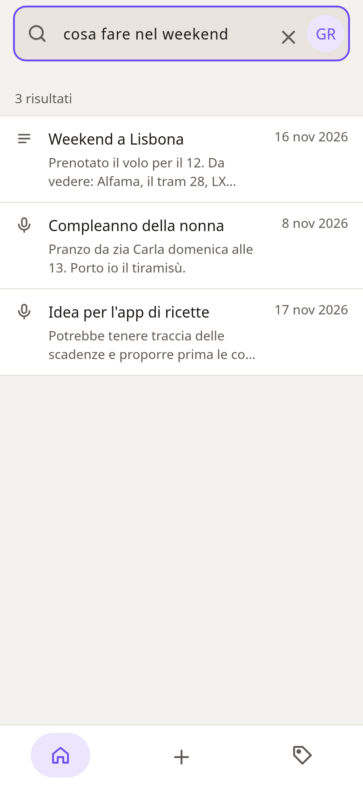
</picture>
<br><sub>Ricerca semantica: trova le note per significato</sub>
</td>
</tr>
<tr>
<td align="center" width="33%">
<picture>
  <source media="(prefers-color-scheme: dark)" srcset="docs/screenshots/record-dark.png">
  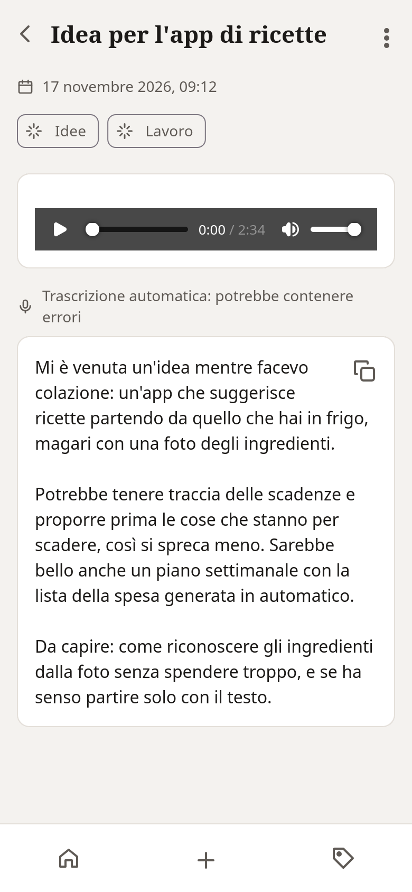
</picture>
<br><sub>Trascrizione automatica, audio e tag assegnati dall'AI</sub>
</td>
<td align="center" width="33%">
<picture>
  <source media="(prefers-color-scheme: dark)" srcset="docs/screenshots/tags-dark.png">
  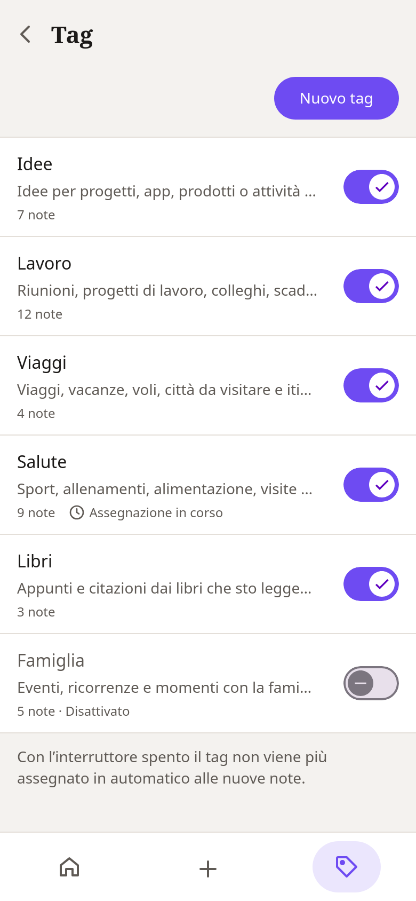
</picture>
<br><sub>Tag definiti dall'utente, assegnati in automatico</sub>
</td>
<td align="center" width="33%">
<picture>
  <source media="(prefers-color-scheme: dark)" srcset="docs/screenshots/admin-dark.png">
  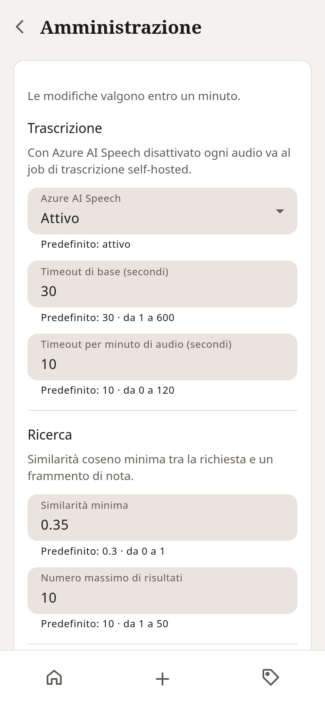
</picture>
<br><sub>Parametri di sistema modificabili a runtime</sub>
</td>
</tr>
</table>

<sub>Screenshot generati con dati di esempio; l'immagine segue il tema chiaro o scuro di GitHub, come l'app.</sub>

## Architettura

Il frontend comunica solo con le Azure Functions tramite API autenticate. Tutta l'elaborazione delle note è **asincrona e guidata da eventi**: i file vengono caricati direttamente su Blob Storage con un URL SAS di sola scrittura, Event Grid notifica ogni nuovo file e una catena di code Storage Queue porta la nota attraverso validazione, normalizzazione, trascrizione, indicizzazione e assegnazione dei tag.

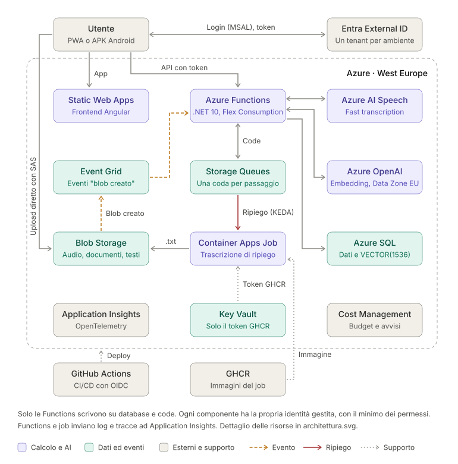

Ogni componente ha una propria **identità gestita user-assigned** con il minimo dei permessi (il job di trascrizione, per esempio, non può scrivere nel database né sulle code). Key Vault contiene solo l'unica credenziale non sostituibile con un'identità: il token per scaricare le immagini da GitHub Container Registry.

<details>
<summary>Diagramma dettagliato delle risorse Azure</summary>

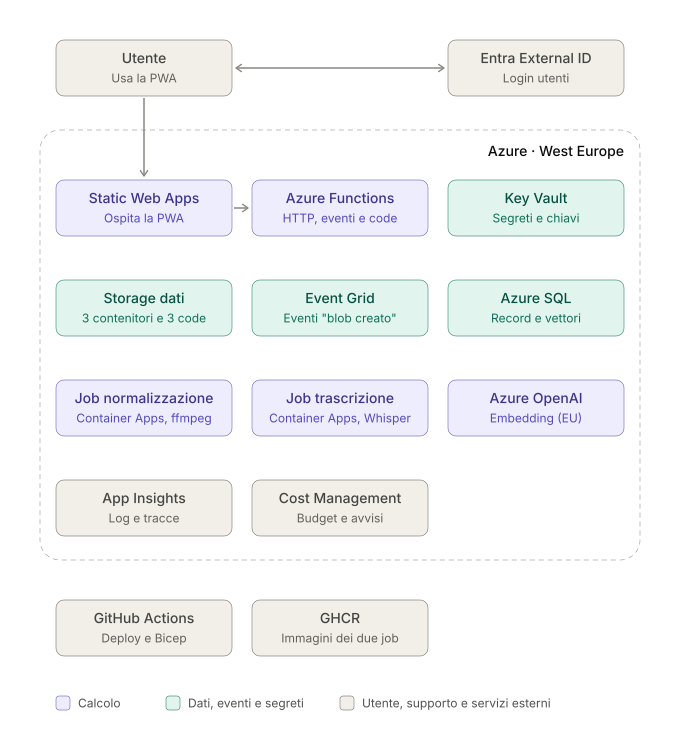

</details>

### Pipeline di elaborazione di una nota audio

Ogni passaggio legge da un contenitore o da una coda e scrive in un altro: nessuna orchestrazione centrale, ogni Function fa una sola cosa ed è **idempotente**, perché Event Grid e le code consegnano i messaggi almeno una volta.

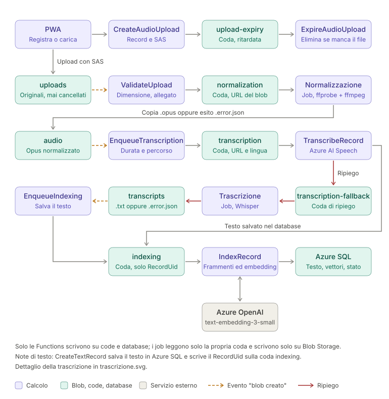

Le note scritte entrano direttamente dalla fase di indicizzazione; i documenti (PDF, MD, TXT) seguono un percorso analogo all'audio, con una Function di estrazione del testo (PdfPig) al posto di normalizzazione e trascrizione.

### Trascrizione con ripiego

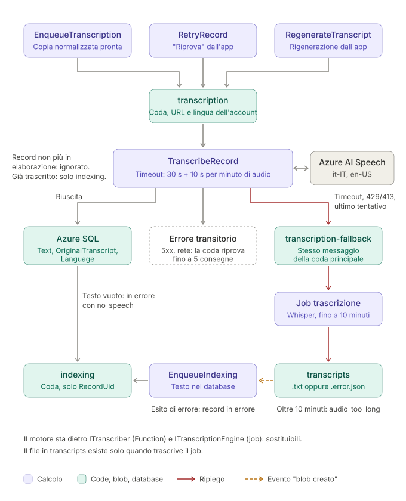

La trascrizione principale usa **Azure AI Speech** (fast transcription). Se il servizio non risponde in tempo, supera i limiti o viene disattivato con una feature flag, il messaggio passa a una coda di ripiego che avvia, tramite KEDA, un **Container Apps Job** self-hosted su CPU. Il motore è intercambiabile dietro un'interfaccia comune, con un'immagine Docker per motore:

| Motore | Runtime | Punti di forza |
|---|---|---|
| Whisper large-v3-turbo | Whisper.net (whisper.cpp) | Qualità, rilevamento della lingua |
| Parakeet TDT 0.6B v3 | sherpa-onnx (ONNX Runtime) | Il più veloce, punteggiatura nativa, fino a 30 minuti |
| faster-whisper large-v3-turbo | CTranslate2 (Python avviato da .NET) | La migliore qualità nelle prove |

Il job resta nel grant gratuito di Container Apps: il tempo di elaborazione è anche il costo.

### Ricerca semantica e tag

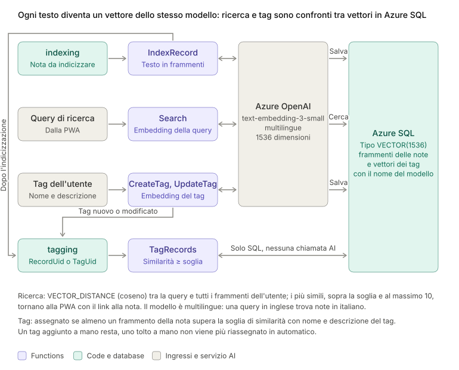

- I vettori sono salvati con il tipo nativo **`VECTOR` di Azure SQL** (EF Core 10, `SqlVector<float>`), senza un database vettoriale separato: la ricerca esatta con `VECTOR_DISTANCE` è più che sufficiente per il volume di dati e non aggiunge costi.
- Il modello di embedding è multilingue, quindi la ricerca funziona anche tra italiano e inglese.
- L'assegnazione dei tag è solo un confronto SQL tra vettori già calcolati: nessuna chiamata ad Azure OpenAI per nota. Un tag tolto a mano non viene più riassegnato, uno aggiunto a mano non viene toccato dall'automatismo.

### Autenticazione

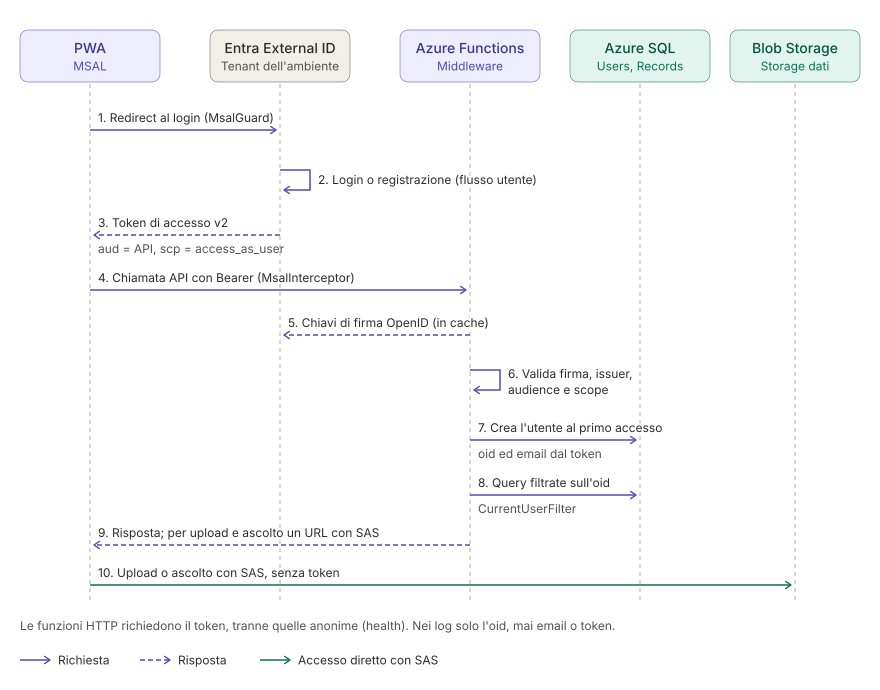

Login con **Microsoft Entra External ID** (un tenant per ambiente) tramite MSAL nel frontend; le Functions validano il token a ogni richiesta e operano solo sui dati dell'utente autenticato.

## Scelte tecniche

| Area | Tecnologia |
|---|---|
| Frontend | Angular 22, Angular Material, PWA con service worker (cache solo dell'app, mai dei dati), Static Web Apps |
| Mobile | APK Android Trusted Web Activity, pubblicato come GitHub Release |
| Backend | C# .NET 10, Azure Functions isolated worker su piano Flex Consumption |
| Dati | Azure SQL serverless (offerta gratuita) con EF Core 10 e tipo `VECTOR`; Blob Storage con soft delete, versioning e tiering automatico |
| Messaggistica | Event Grid (eventi "blob creato" filtrati per contenitore) + Storage Queues con code dei messaggi non elaborabili |
| AI | Azure AI Speech, Azure OpenAI (embedding, Data Zone EU), Whisper / Parakeet / faster-whisper self-hosted |
| Audio | ffmpeg statico incluso nel pacchetto delle Functions, normalizzazione in Ogg Opus mono |
| Identità e sicurezza | Entra External ID, identità gestite user-assigned per componente, Key Vault, nessun segreto nel repository |
| Infrastruttura | Bicep (anche per le registrazioni delle app Entra, tramite l'estensione Microsoft Graph), ambienti dev e prod |
| CI/CD | GitHub Actions con OIDC verso Azure: pipeline separate per frontend, Functions, schema del database, immagini di trascrizione e APK |
| Osservabilità | OpenTelemetry + Application Insights, con filtro dei dati sensibili; workbook e oltre 30 query KQL versionate |

### Alcune decisioni di cui vado fiero

- **Upload diretto su Blob Storage con SAS** limitato a un solo file e in sola scrittura: le Functions non trasportano mai i byte dell'audio, e un upload mai completato viene ripulito da un messaggio in coda con visibilità ritardata (nessun timer che interroga il database).
- **Migration del database solo da pipeline**, come script SQL idempotente, mai all'avvio dell'app; ogni modifica allo schema è in due tempi, compatibile con il codice vecchio e nuovo.
- **Privacy by design**: nelle code e nei log solo identificativi, mai testi o trascrizioni; un processore OpenTelemetry dedicato filtra ciò che le strumentazioni raccolgono in automatico.
- **Costi sotto controllo**: budget Azure con avvisi, limite giornaliero di ingestione dei log, tier dei blob Cold/Cool dopo pochi giorni, database serverless con pausa automatica.

## Struttura del repository

```
src/
├── web/                 # PWA Angular
├── android/             # APK Trusted Web Activity
├── functions/           # Azure Functions (.NET): API HTTP e handler di eventi e code
├── jobs/transcriber/    # Container Apps Job di trascrizione (Whisper, Parakeet, faster-whisper)
└── shared/              # Contratti della pipeline e osservabilità condivisi
infra/                   # Bicep: risorse Azure, identità, monitoraggio, query KQL
docs/                    # Decisioni di progetto, schemi, guide di sviluppo
.github/workflows/       # Pipeline CI/CD
```

## Documentazione

La documentazione completa, funzionale e tecnica, è in italiano:

- [Decisioni di progetto](docs/project.md): funzionalità, architettura e scelte tecniche, con le alternative valutate e il loro impatto su costi e limiti
- [Sviluppo in locale](docs/debug/sviluppo-locale.md): configurazione, avvio, database e migration
- [Simulazione degli eventi](docs/debug/simulazione-eventi.md): test manuali della pipeline in locale
- [Infrastruttura](infra/README.md): deploy e passi manuali
