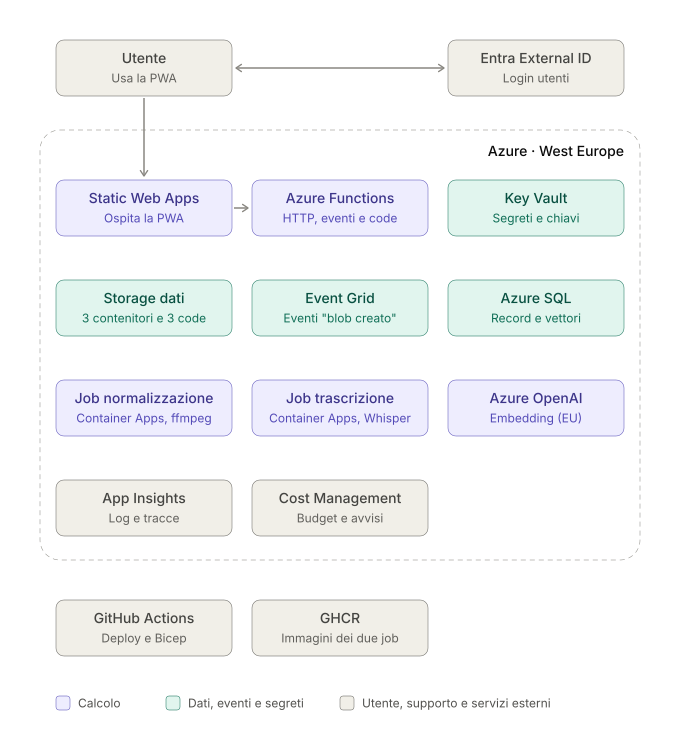

# Memoa – Decisioni di progetto

Documento delle decisioni, diviso per area. Ogni file della sezione tecnica riporta per ciascuna scelta la decisione presa, le opzioni valutate e l'impatto (costi, limiti, alternative scartate).

Contesto: al massimo 10 utenti nella fase iniziale, budget di manutenzione massimo di circa 10 € al mese.

## Funzionalità

[funzionalita.md](project/funzionalita.md): funzionalità dell'MVP con priorità e stato di implementazione, e vincoli su formati, dimensioni e lingue.

## Scelte tecniche

| Area | Scelte | Decisioni in breve |
|---|---|---|
| [Frontend](project/frontend.md) | [App](project/frontend.md#app) · [Struttura](project/frontend.md#struttura) · [Registrazione audio](project/frontend.md#registrazione-audio) · [Upload](project/frontend.md#upload) · [Aggiornamento dello stato](project/frontend.md#aggiornamento-dello-stato) · [Hosting](project/frontend.md#hosting) · [Interfaccia](project/ui.md) | PWA Angular su Static Web Apps Free, login MSAL; registrazione nel formato nativo del browser normalizzata in Opus; upload diretto con SAS; polling dello stato |
| [Backend ed elaborazione](project/backend-elaborazione.md) | [Backend](project/backend-elaborazione.md#backend) · [Normalizzazione](project/backend-elaborazione.md#normalizzazione) · [Flusso audio](project/backend-elaborazione.md#flusso-audio) · [Flusso testo](project/backend-elaborazione.md#flusso-testo) · [Riprova e rigenerazione](project/backend-elaborazione.md#riprova-e-rigenerazione) · [Regole](project/backend-elaborazione.md#regole) · [Retry ed errori](project/backend-elaborazione.md#retry-ed-errori) · [Registry delle immagini](project/backend-elaborazione.md#registry-delle-immagini) | Azure Functions Flex Consumption; Event Grid + Storage Queue; normalizzazione in una Function con ffmpeg statico nel pacchetto; ripiego della trascrizione in un Container Apps Job; nessuna orchestrazione; immagini su GHCR |
| [Dati](project/dati.md) | [Database](project/dati.md#database) · [Accesso ai dati e migration](project/dati.md#accesso-ai-dati-e-migration) · [Storage dei file](project/dati.md#storage-dei-file) · [Backup](project/dati.md#backup) · [Schema](project/schema.md) | Azure SQL gratuito serverless con tipo VECTOR; EF Core 10 e migration da pipeline dedicata; Blob Storage dedicato; backup e GRS |
| [Trascrizione e modelli AI](project/trascrizione-ai.md) | [Trascrizione](project/trascrizione-ai.md#trascrizione) · [Ripiego con Whisper](project/trascrizione-ai.md#ripiego-con-whisper) · [Embedding](project/trascrizione-ai.md#embedding) · [Da definire](project/trascrizione-ai.md#da-definire) | Azure AI Speech fast transcription con ripiego Whisper self-hosted; text-embedding-3-small Data Zone EU a frammenti |
| [Sicurezza, identità e regione](project/sicurezza-identita.md) | [Autenticazione](project/sicurezza-identita.md#autenticazione) · [Identità gestite](project/sicurezza-identita.md#identità-gestite) · [Segreti](project/sicurezza-identita.md#segreti) · [Regione dei dati](project/sicurezza-identita.md#regione-dei-dati) | Entra External ID con un tenant per ambiente; un'identità user-assigned per componente; Key Vault solo per il token GHCR; West Europe |
| [Infrastruttura e operatività](project/infrastruttura.md) | [Infrastruttura come codice](project/infrastruttura.md#infrastruttura-come-codice) · [Ambienti](project/infrastruttura.md#ambienti) · [Pipeline](project/infrastruttura.md#pipeline) · [Monitoraggio e log](project/infrastruttura.md#monitoraggio-e-log) · [Controllo dei costi](project/infrastruttura.md#controllo-dei-costi) · [Dominio ed email](project/infrastruttura.md#dominio-ed-email) | Bicep (anche per Entra tramite Graph); dev e prod nella stessa sottoscrizione; GitHub Actions con OIDC; Application Insights entro le soglie gratuite; budget 10 € |

## Diagrammi

In [schemas/](schemas/):

- [architettura.svg](schemas/architettura.svg): risorse Azure e servizi esterni
- [flusso-audio.svg](schemas/flusso-audio.svg): una nota audio dall'upload all'indicizzazione ([backend-elaborazione.md](project/backend-elaborazione.md#flusso-audio))
- [trascrizione.svg](schemas/trascrizione.svg): Azure AI Speech, retry e ripiego Whisper ([trascrizione-ai.md](project/trascrizione-ai.md#trascrizione))
- [autenticazione.svg](schemas/autenticazione.svg): login, token e accesso ai dati ([sicurezza-identita.md](project/sicurezza-identita.md#autenticazione))

## Documenti collegati

- [ui.md](project/ui.md): interfaccia utente della PWA
- [schema.md](project/schema.md): struttura del database

## Guide di sviluppo e debug

In [debug/](debug/):

- [sviluppo-locale.md](debug/sviluppo-locale.md): configurazione, avvio e migration in locale
- [simulazione-eventi.md](debug/simulazione-eventi.md): test manuali della pipeline in locale, con gli script in [debug/scripts/](debug/scripts/)
