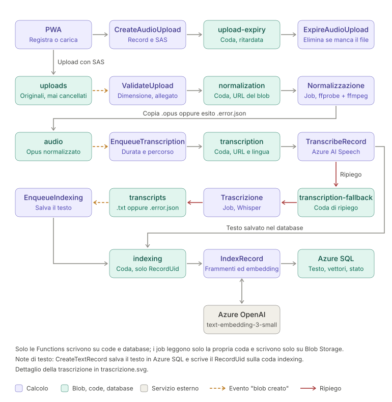

# Backend ed elaborazione

[← Indice del progetto](../project.md)

Backend su Azure Functions ed elaborazione asincrona dei record con eventi, code, Functions e un Container Apps Job (ripiego della trascrizione).

Contenuti: [Backend](#backend) · [Normalizzazione](#normalizzazione) · [Componenti](#componenti) · [Flusso audio](#flusso-audio) · [Flusso testo](#flusso-testo) · [Tag](#tag) · [Riprova e rigenerazione](#riprova-e-rigenerazione) · [Eliminazione](#eliminazione) · [Regole](#regole) · [Event Grid](#event-grid) · [Retry ed errori](#retry-ed-errori) · [Registry delle immagini](#registry-delle-immagini) · [Appendice: alternative scartate](#appendice-alternative-scartate)

---

## Backend

**Decisione**: C# .NET su Azure Functions, piano Flex Consumption.

- Grant gratuito mensile: 250.000 esecuzioni e 100.000 GB-s per sottoscrizione. Lo storage account di sistema delle Functions costa pochi centesimi.
- Senza istanze "always ready" ci sono cold start.
- Niente modelli pesanti (Whisper) nelle Functions: il ripiego della trascrizione gira in un Container Apps Job. ffmpeg invece sì, come binario statico nel pacchetto (vedi [Normalizzazione](#normalizzazione)).

---

## Normalizzazione

**Decisione**: Function `NormalizeRecord`, attivata dalla coda `normalization`, con la build statica di ffmpeg inclusa nel pacchetto di deploy. Ha sostituito il Container Apps Job di normalizzazione (vedi [alternative scartate](#appendice-alternative-scartate)).

- **Build**: [eugeneware/ffmpeg-static](https://github.com/eugeneware/ffmpeg-static), Linux x64. La release `b6.1.1` contiene ffmpeg 7.0.2 con libopus.
- **Come arriva nel pacchetto**: la pipeline delle Functions scarica il binario, ne verifica lo SHA-256 (release e hash fissati nel workflow) e lo copia con la licenza in `tools/ffmpeg/`. Occupa circa 76 MB.
- **Solo ffmpeg, senza ffprobe**: formato, stream e durata si leggono dal riepilogo che `ffmpeg -i` scrive su stderr. Si risparmiano circa 75 MB nel pacchetto. Quel testo può contenere i metadati del file e non va mai nei log.
- **Permesso di esecuzione**: se lo zip lo perde, al primo uso ffmpeg viene copiato nella cartella temporanea e reso eseguibile.
- **Una normalizzazione alla volta per istanza**: lo spazio temporaneo di Flex Consumption (0,8 GB) basta per un originale da 350 MB, la copia e ffmpeg, non per più file in parallelo.
- **Contratto blob**: copia `.opus` o esito `.error.json` in `audio`. Il flusso prosegue da Event Grid e la Function non accede al database.
- **Effetti**: niente immagine su GHCR, identità, ruoli e pipeline dedicati, né avvio KEDA. Il pacchetto delle Functions cresce di circa 76 MB, con possibile impatto sul cold start.

---

## Componenti

Tutto sta nello storage account dedicato ai dati utente (blob e code), con un system topic Event Grid.

| Contenitore | Chi scrive | Contenuto | Evento "blob creato" → |
|---|---|---|---|
| `uploads` | client (SAS) | originale `<oid>/<RecordUid>` | `ValidateUpload` |
| `audio` | `NormalizeRecord` | `<oid>/<RecordUid>.opus` (durata nei metadati) oppure `<oid>/<RecordUid>.error.json` | `EnqueueTranscription` |
| `transcripts` | job di trascrizione (solo ripiego) | `<oid>/<RecordUid>.txt` (lingua nei metadati) oppure `<oid>/<RecordUid>.error.json` | `EnqueueIndexing` |

Negli esiti `.error.json` il codice d'errore sta nei metadati del blob.

| Coda | Messaggio | Chi legge |
|---|---|---|
| `normalization` | URL dell'originale | `NormalizeRecord` |
| `transcription` | `TranscriptionRequest`: URL della copia `.opus` e lingua dell'account | `TranscribeRecord` |
| `transcription-fallback` | stesso `TranscriptionRequest` | job di trascrizione (Whisper, Parakeet o faster-whisper) |
| `indexing` | RecordUid | `IndexRecord` |
| `tagging` | `TaggingRequest`: RecordUid oppure TagUid | `TagRecords` |
| `upload-expiry` | RecordUid, invisibile fino alla scadenza del SAS + 15 minuti | `ExpireAudioUpload` |

---

## Flusso audio

1. **`CreateAudioUpload`** (HTTP): riceve titolo e data della nota, crea il record "in elaborazione", sceglie il percorso del blob e restituisce un SAS valido solo per creare quel file. Scrive anche il messaggio ritardato su `upload-expiry`.
2. Il client carica il file direttamente in `uploads`. Se l'upload fallisce chiama **`CancelAudioUpload`**, che elimina il record (409 se il file è già arrivato). Se il client non lo fa, alla scadenza **`ExpireAudioUpload`** elimina il record senza file.
3. **`ValidateUpload`** (Event Grid): controlla la dimensione senza leggere il file (vuoto o oltre 350 MB), collega il file come allegato e scrive l'URL su `normalization`. Se il file non è valido porta il record a "in errore" e non accoda nulla; il file resta, per poterlo analizzare.
4. **`NormalizeRecord`** (coda): `ffmpeg` verifica formato reale e durata e crea la copia Ogg Opus in `audio`. Se il file va scartato scrive invece l'esito `.error.json`.
5. **`EnqueueTranscription`** (Event Grid): per la copia `.opus` salva percorso e durata e scrive su `transcription`; per l'esito porta il record a "in errore".
6. **`TranscribeRecord`** (coda): invia la copia ad Azure AI Speech con timeout di 30 s + 10 s per minuto di audio, salva testo (`Text` e `OriginalTranscript`) e lingua nel database e scrive il RecordUid su `indexing`. Se il servizio non risponde entro il timeout, restituisce 429/413 o fallisce all'ultimo tentativo, inoltra il messaggio su `transcription-fallback`. Con la feature flag `Speech__Enabled` a `false` (`useAzureSpeech` in `infra/main.bicep`) non chiama il servizio e inoltra subito ogni messaggio, dopo aver controllato record e copia normalizzata.
7. **Ripiego**: il job di trascrizione (Whisper o faster-whisper, solo audio fino a 10 minuti, oppure Parakeet, fino alla durata massima dell'app) scrive `.txt` o `.error.json` in `transcripts`. **`EnqueueIndexing`** (Event Grid) salva testo e lingua e scrive su `indexing`, oppure porta il record a "in errore".
8. **`IndexRecord`** (coda): divide il testo in frammenti, ne calcola gli embedding (nella stessa richiesta anche quello del titolo), li sostituisce in una transazione e porta il record a "pronto". Poi scrive il RecordUid su `tagging` (anche per un messaggio duplicato su un record già pronto, così un errore di scrittura sulla coda dopo il salvataggio non fa perdere i tag).
9. **`TagRecords`** (coda): assegna i tag automatici (vedi [Tag](#tag)).

Dettagli di trascrizione ed embedding in [trascrizione-ai.md](trascrizione-ai.md).

---

## Flusso testo

**`CreateTextRecord`** (HTTP) salva testo, titolo e data nel database e scrive il RecordUid su `indexing`. Da lì prosegue come i punti 8 e 9 del flusso audio. Il testo resta nel database, mai su Blob Storage né nelle code.

---

## Tag

Tag per utente, con nome (massimo 50 caratteri, univoco per utente) e descrizione facoltativa (massimo 2.000), assegnati in automatico per similarità semantica o a mano dalla pagina del record.

- **Embedding del tag**: calcolati subito dalla Function HTTP (`CreateTag`, `UpdateTag`), alla creazione e quando nome o descrizione cambiano: uno su nome e descrizione, uno sul solo nome (senza descrizione coincidono). Se Azure OpenAI non risponde la richiesta fallisce (503) e nulla viene salvato.
- **Embedding del titolo della nota**: calcolato da `IndexRecord` insieme ai frammenti. Se l'utente cambia il titolo di una nota pronta, `UpdateRecord` lo ricalcola subito (503 se Azure OpenAI non risponde, nulla salvato) e accoda la nota su `tagging`; negli altri stati lo azzera e lo ricalcolerà l'indicizzazione.
- **Assegnazione automatica** (`TagRecords`, coda `tagging`): un record riceve un tag attivo se almeno uno dei suoi frammenti ha con il tag (nome e descrizione) una similarità coseno pari almeno alla soglia `Tagging__MinSimilarity` (0,35, da tarare), **oppure** se la raggiunge il titolo del record con il nome del tag. La similarità salvata è la maggiore tra le due. Si confrontano solo vettori dello stesso modello già salvati nel database: nessuna chiamata ad Azure OpenAI.
  - **Per record**: dopo l'indicizzazione e dopo una modifica del titolo, confronto con tutti i tag attivi dell'utente.
  - **Per tag**: alla creazione, a una modifica di nome o descrizione e alla riattivazione, confronto con tutti i record pronti dell'utente.
- **Origine dell'assegnazione** (`RecordTags.Source`): `Auto`, `Manual` o `Excluded`. L'assegnazione automatica sostituisce in una transazione solo le righe `Auto`; le manuali restano e un tag tolto dall'utente diventa `Excluded`, quindi non viene riassegnato.
- **Tag disattivato**: escluso dalle assegnazioni automatiche successive; quelle già fatte restano.
- **Assegnazione manuale** (`SetRecordTags`, `PUT /records/{uid}/tags`): il client invia tutti i tag visibili della nota. Quelli nuovi si creano prima con `CreateTag`.
- **Idempotenza**: una riga per coppia (RecordId, TagId); un conflitto tra esecuzioni concorrenti fa riprovare la coda.
- **Stato dell'assegnazione**: `Assigning` o `Ready`, calcolato a ogni lettura (non salvato), per evitare che più note elaborate insieme si scavalchino. Un tag è `Assigning` se:
  - ha un ricalcolo in attesa (`Tags.AssignmentPendingSince`, impostato da `CreateTag` e da `UpdateTag` quando accoda il tag), oppure
  - è attivo e almeno una nota dell'utente non in errore attende il confronto (`Records.TagsPendingSince`, impostato quando la nota entra in elaborazione: creazione, modifica del testo, riprova, rigenerazione).
- **Fine dell'attesa**: `TagRecords` azzera il timestamp nella stessa transazione delle assegnazioni, solo se è ancora quello letto all'inizio (una modifica successiva ne apre uno nuovo). Lo azzera anche quando ignora un tag disattivato e, all'ultimo tentativo fallito, prima che il messaggio vada nella coda dei non elaborabili. Una rigenerazione con testo invariato lo azzera subito (nessun confronto da fare). Una nota in errore non conta.
- **Timeout**: un'attesa più vecchia di `Tagging__PendingTimeoutMinutes` (15 minuti) non conta più, così un processo fallito senza ripulire non lascia il tag bloccato. Con l'attesa che parte dall'inizio dell'elaborazione, un audio lungo trascritto dal ripiego può superarla: il tag torna `Ready` prima del confronto, che avviene comunque.

---

## Riprova e rigenerazione

- **`RetryRecord`** (HTTP, record "in errore") riparte dal passo fallito:
  - record con testo: solo indicizzazione, senza perdere le correzioni dell'utente;
  - audio con testo ma senza `OriginalTranscript` (rigenerazione fallita): di nuovo la trascrizione;
  - audio senza testo: di nuovo la normalizzazione, dopo aver eliminato copia normalizzata, trascrizione ed esiti di errore.
- **`RegenerateTranscript`** (HTTP, audio "pronto"): elimina trascrizione ed esito del ripiego, azzera `OriginalTranscript` e accoda di nuovo su `transcription`. Il testo corrente resta finché non arriva quello nuovo. L'indicizzazione si rifà solo se il testo cambia.

Entrambe passano dalla coda di trascrizione, quindi prima Azure AI Speech e poi, se serve, il ripiego.

---

## Eliminazione

- **`DeleteRecord`** (HTTP): elimina tutti i blob del record, originale compreso, poi le righe (allegati, frammenti e assegnazioni dei tag a cascata).
- **`DeleteTag`** (HTTP): elimina in una transazione le assegnazioni del tag e il tag; le note restano.
- **`DeleteAccount`** (HTTP, `DELETE /me`): elimina tutti i blob dell'utente (prefisso `<oid>/` in `uploads`, `audio` e `transcripts`, compresi i file rimasti di record già eliminati), poi le assegnazioni dei tag e l'utente applicativo con record, allegati, frammenti e tag a cascata. L'utente in Entra External ID per ora resta: al login successivo trova un account vuoto (vedi [sicurezza-identita.md](sicurezza-identita.md#da-definire)).
- Prima i blob, poi il database: se il database fallisce l'utente può riprovare, mentre l'ordine inverso lascerebbe file senza record. Ogni passo è idempotente.
- **Messaggi in coda**: non vengono rimossi (quelli invisibili, come `upload-expiry`, non si possono leggere). Contengono solo identificativi e URL di blob, e gli handler ignorano i record che non esistono più.
- I file eliminati restano recuperabili per 14 giorni (soft delete dello storage).
- **Limiti noti**: un record ancora in elaborazione può far scrivere un blob alla pipeline dopo l'eliminazione, e il file resta; dopo l'eliminazione dell'account, una richiesta da un'altra scheda aperta ricrea un utente applicativo vuoto.

---

## Regole

- Solo le Functions scrivono nel database e sulle code.
- Il job di trascrizione legge solo la propria coda e scrive solo nel proprio contenitore di destinazione: niente code, niente Azure SQL. È una trasformazione audio → testo indipendente dal motore.
- `NormalizeRecord` scrive solo nel contenitore `audio`: niente database né code, il flusso prosegue dall'evento "blob creato".
- Ogni passaggio scrive in un contenitore diverso da quello che legge, quindi non ci sono cicli.
- L'originale non viene mai cancellato né sovrascritto, salvo eliminazione del record o dell'account. Anche i file scartati dalla validazione restano, per poterli analizzare. "Riprova" e rigenerazione eliminano solo i file derivati (copia normalizzata, trascrizione, esiti).
- Il file di trascrizione su Blob Storage esiste solo quando trascrive il job.
- Messaggi di coda: solo identificativi o URL di blob (senza SAS), mai testi, nomi o descrizioni dei tag.
- Idempotenza obbligatoria: Event Grid e code consegnano almeno una volta. Gli handler ignorano i messaggi di record non più "in elaborazione" e le Functions HTTP agiscono solo su record nello stato atteso.
- Se l'indicizzazione fallisce il testo è già nel database.
- Nessuna orchestrazione e nessun timer sul database.

---

## Event Grid

- Piano Basic: 100.000 operazioni gratuite al mese, poche migliaia a questi volumi.
- Un system topic sullo storage dei dati, una sottoscrizione per contenitore: filtro su `Microsoft.Storage.BlobCreated` e `subjectBeginsWith: /blobServices/default/containers/<contenitore>/`.
- Endpoint di tipo `AzureFunction` (resourceId della funzione, nessuna chiave), un evento per batch.
- Le sottoscrizioni si possono creare solo con le funzioni già deployate: vanno distribuite dopo il codice ([infra/README.md](../../infra/README.md)).
- Sul piano Flex Consumption il blob trigger a polling non è supportato: si usa solo l'Event Grid trigger.
- Il Container Apps Job non si avvia da Event Grid, ma dalla coda tramite lo scaler KEDA `azure-queue` (`queueLengthStrategy: visibleonly`).
- In locale Azurite non emette eventi: vanno simulati con una POST a `/runtime/webhooks/EventGrid?functionName=<Nome>` e header `aeg-event-type: Notification` (procedura e script in [simulazione-eventi.md](../debug/simulazione-eventi.md)).

---

## Retry ed errori

- **Functions su coda**: massimo 5 consegne (`host.json`), poi la coda dei messaggi non elaborabili. All'ultimo tentativo `TranscribeRecord` passa al ripiego, `NormalizeRecord` scrive l'esito `processing_failed` e `IndexRecord` porta il record a "in errore" (`indexing_failed`).
- **Job di trascrizione**: `replicaRetryLimit: 0`. I retry sono quelli della coda, con massimo 3 consegne e VisibilityTimeout di 65 minuti. Il job non può scrivere sulla coda dei messaggi non elaborabili: all'ultimo tentativo, o per errori deterministici, scrive l'esito `.error.json` (`processing_failed` se la causa non è nota).
- **Event Grid**: solo i retry automatici (30 tentativi in 24 ore), nessun dead-letter. Gli eventi non consegnati vanno persi (gestione da definire).
- Stati del record: "in elaborazione", "pronto", "in errore", con codice d'errore.

---

## Registry delle immagini

**Decisione**: GitHub Container Registry, immagini private del job di trascrizione, una per motore con i propri modelli: `memoa-transcriber` (Whisper), `memoa-transcriber-parakeet` e `memoa-transcriber-faster-whisper`. Il motore in uso lo sceglie `transcriberEngine` nel deploy dell'infrastruttura; la pipeline aggiorna il job solo con l'immagine dello stesso motore.

- Gratuito a questi volumi. Push dalle GitHub Actions con `GITHUB_TOKEN`.
- Container Apps non supporta le identità gestite su registry diversi da ACR: il pull usa un personal access token con scope `read:packages`, salvato in Key Vault.

---

## Appendice: alternative scartate

**Backend**: Backend-as-a-Service (Supabase, Firebase), server su VPS.

**Orchestrazione con Durable Functions**: valutata con backend Azure Storage, SQL e Durable Task Scheduler. Il Durable Task Scheduler (SKU Consumption) costa 0,00429 $ per azione nel listino di West Europe (ottobre 2026): circa 0,04 $ per record con 10 azioni, quindi fuori budget già con poche centinaia di record al mese. Lo SKU Dedicated costa circa 715 $ al mese. La documentazione indica un prezzo "per milione di azioni", in contrasto con il listino: da chiarire se si rivaluta.

**Trigger degli eventi**: blob trigger con source EventGrid. Richiede un endpoint WebHook con la chiave `blobs_extension` nell'URL, URL non modificabile dopo la creazione e una coda sullo storage di sistema delle Functions.

**Normalizzazione in un Container Apps Job** (scelta precedente, worker .NET con ffmpeg nell'immagine): più componenti da gestire (immagine su GHCR, token in Key Vault, identità, pipeline) e avvio più lento tramite KEDA.

**ffmpeg su una condivisione Azure Files montata nella Function**: la condivisione non supporta le identità gestite. Il binario nel pacchetto non ha bisogno di montaggi.

**ffprobe nel pacchetto**: circa 75 MB in più per informazioni che ffmpeg dà già.

**Build di BtbN/FFmpeg-Builds**: binario più grande, e le release datate vengono eliminate dopo un po' (resta solo il tag mobile `latest`), quindi la build non è riproducibile.

**Worker di normalizzazione in bash** (curl + ffmpeg): nessuna telemetria, chiamate REST e parsing XML fragili.

**Esito della normalizzazione**: nessun esito per i file scartati (record bloccati "in elaborazione"); contenitore dedicato agli esiti (una sottoscrizione e una Function in più).

**Notifica di fine upload**: conferma dal client (file orfani e record bloccati se l'app si chiude); evento scritto direttamente sulla coda (nessuna validazione prima del job).

**Notifica di fine trascrizione del job**: chiamata HTTP alla Function; timer sul database (tiene sveglio il database serverless); embedding nel job; scrittura del job sulla coda di indicizzazione (accesso in scrittura alle code).

**Passaggio della trascrizione dal job**: scrittura diretta nel database (due componenti con accesso in scrittura); testo nel messaggio di coda (limite di 64 KB, dati personali nelle code).

**Service Bus**: non necessario a questi volumi.
