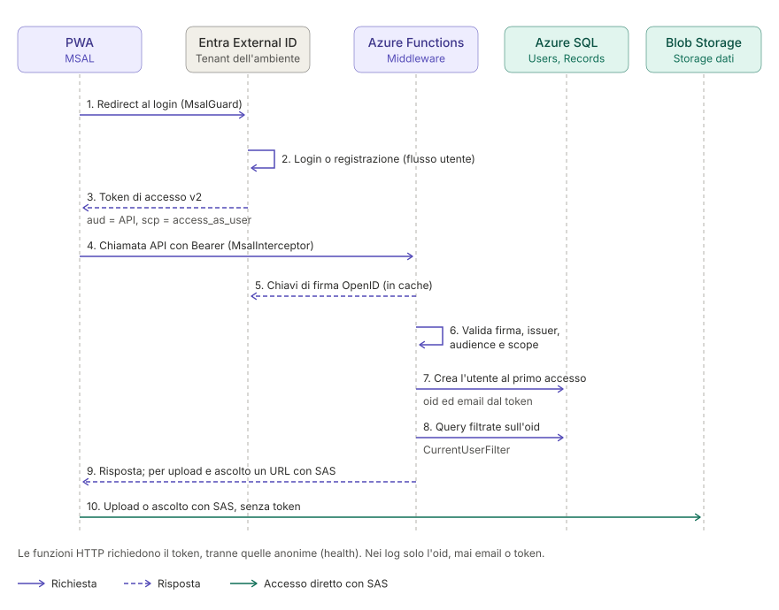

# Sicurezza, identità e regione

[← Indice del progetto](../project.md)

Autenticazione degli utenti, identità gestite, segreti e residenza dei dati.

Contenuti: [Autenticazione](#autenticazione) · [Identità gestite](#identità-gestite) · [Segreti](#segreti) · [Regione dei dati](#regione-dei-dati) · [Da definire](#da-definire) · [Appendice: alternative scartate](#appendice-alternative-scartate)

---

## Autenticazione

**Decisione**: Microsoft Entra External ID, un tenant esterno per ambiente (dev e prod), località Europa, collegato alla sottoscrizione tramite un gruppo di risorse dedicato non gestito da Bicep.

- **Tenant esterno**, non il tenant workforce dell'account Azure ("Directory predefinita"). Gestisce registrazione, conferma email e reset password.
- **Costo**: gratuito fino a 50.000 utenti attivi al mese, sommando i tenant collegati alla sottoscrizione. I componenti premium (es. SMS) sono a pagamento.
- **Un tenant per ambiente**: utenti di test e reali separati, modifiche provabili su dev senza rischi. Flussi utente e branding vanno configurati a mano su entrambi.
- Ogni tenant ha il proprio `<dominio>.ciamlogin.com`, quindi authority e audience sono per ambiente. La località non è modificabile dopo la creazione.
- **Gruppo di risorse del tenant**: mai nei deployment stacks, che eliminerebbero le risorse tolte dal codice.
- **Registrazioni delle app** (`infra/identity/main.bicep`, estensione Microsoft Graph, deploy a livello di tenant):
  - API: token v2 (`aud` = client ID dell'API), scope `access_as_user`, claim opzionale `email`;
  - frontend (SPA): redirect URI della Static Web App più quelli locali, permessi per l'API e per `openid offline_access`, con consenso dell'amministratore (nei tenant esterni gli utenti non possono concederlo).
- **Frontend**: login con MSAL. Il token va alle Functions con CORS abilitato solo per le origini del frontend.
- **Functions**: un middleware valida il bearer token su tutte le funzioni HTTP, tranne quelle marcate anonime. Controlla firma e issuer dal documento OpenID del tenant, audience e scope `access_as_user`. L'utente applicativo lo crea solo `GET /me`, che il frontend chiama all'apertura della homepage: un secondo middleware risponde `403` con `{ "error": "user_not_registered" }` a tutte le altre funzioni autenticate finché l'utente non esiste (le funzioni marcate `[AllowUnregisteredUser]`, oggi solo `GET /me`, passano comunque). Il frontend, ricevuto quel codice, torna alla homepage e chiama di nuovo `/me`. Ogni funzione opera solo sui record dell'utente del token (claim `oid`, l'unico dato dell'utente ammesso nei log).
- **Amministratori**: `Users.IsAdmin`, impostato solo a mano sul database (`UPDATE Users SET IsAdmin = 1 WHERE ...`). Le funzioni dei parametri di sistema (`/system/settings`) lo verificano a ogni richiesta e rispondono `403 admin_required` agli altri utenti. Gli amministratori modificano solo i parametri di sistema, mai i dati degli altri utenti.

---

## Identità gestite

**Decisione**: un'identità user-assigned per componente, nessuna system-assigned. Le identità sono create prima delle risorse, così i ruoli si assegnano senza dipendenze circolari. Minimo privilegio.

| Identità | Accessi |
|---|---|
| Functions | storage dei dati (Blob Data Contributor, Blob Delegator per i SAS, Queue Data Contributor), storage di sistema, Azure SQL (utente del database), Azure OpenAI, Azure AI Speech, Application Insights |
| Job di trascrizione | coda `transcription-fallback` (lettura ed elaborazione), lettura di `audio`, scrittura di `transcripts`, token GHCR in Key Vault, Application Insights |
| Deploy (GitHub Actions) | federated credential OIDC sull'environment GitHub, nessun segreto; ruoli solo su Function App, Static Web App e Container Apps Job; utente del database per le migration |

- Il job non scrive su nessuna coda e non accede ad Azure SQL. `NormalizeRecord` usa l'identità delle Functions.
- Gli utenti del database si creano con T-SQL dopo il deploy ([infra/README.md](../../infra/README.md)).
- In dev gli sviluppatori hanno gli stessi ruoli delle Functions sui dati, perché le Functions in locale usano l'utente di Azure CLI.
- Storage, Azure OpenAI, Azure AI Speech e Application Insights hanno l'autenticazione con chiave disattivata: solo Entra ID.

---

## Segreti

**Decisione**: Azure Key Vault Standard (RBAC, soft delete 90 giorni, purge protection solo in prod) per le sole credenziali non sostituibili da identità gestite. Oggi c'è solo il token GHCR (`read:packages`) per il pull dell'immagine privata, leggibile solo dall'identità del job di trascrizione.

- Costo: nessun costo fisso, solo le operazioni.
- Mai segreti nel repository, nei file di configurazione versionati o nei log.

---

## Regione dei dati

**Decisione**: West Europe (Paesi Bassi) per tutte le risorse Azure, per il GDPR, per la latenza e per evitare traffico tra regioni. La regione dei database SQL gratuiti è fissata da quello esistente. Tenant Entra External ID con residenza dei dati in Europa. Le eccezioni restano in UE: Azure OpenAI con deployment Data Zone Standard (EU), replica GRS dello storage in North Europe.

---

## Da definire

- Cifratura dei dati a riposo con chiavi proprie in Key Vault (da discutere).
- **Eliminazione dell'utente da Entra External ID** quando l'utente elimina l'account. Oggi `DeleteAccount` elimina solo i dati dell'app: nel tenant restano email e credenziali di accesso. Serve una chiamata a Microsoft Graph nel tenant esterno con il permesso applicativo `User.DeleteRestore.All`; il punto di estensione nel codice è `IIdentityAccountService`. L'identità gestita delle Functions sta nel tenant della sottoscrizione, quindi le opzioni sono:
  - **federazione**: app multi-tenant nel tenant della sottoscrizione con una federated credential che si fida dell'identità delle Functions, installata in ogni tenant esterno. Nessun segreto, ma non è confermato che i tenant esterni accettino app multi-tenant di altri tenant: va provato su dev;
  - **segreto in Key Vault**: app nel tenant esterno con un client secret (massimo 2 anni, poi va ruotato) letto dalle Functions. Funziona di sicuro, ma aggiunge una credenziale da gestire.

---

## Appendice: alternative scartate

**Autenticazione**: servizio di autenticazione dedicato, implementazione propria.

**Tenant External ID condiviso tra gli ambienti**: un account di test potrebbe accedere anche a prod, e le modifiche al tenant non si possono provare senza rischi.

**Segreti nelle impostazioni delle app**: sostituiti da identità gestite e riferimenti a Key Vault.
