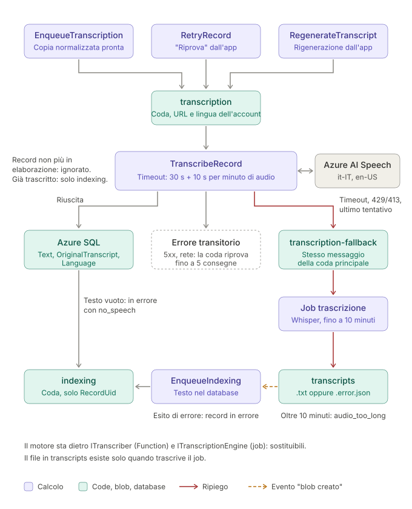

# Trascrizione e modelli AI

[← Indice del progetto](../project.md)

Trascrizione degli audio, embedding per la ricerca semantica e modelli per le funzionalità avanzate. Il flusso che collega questi passaggi è in [backend-elaborazione.md](backend-elaborazione.md).

Contenuti: [Trascrizione](#trascrizione) · [Job di trascrizione](#job-di-trascrizione) · [Embedding](#embedding) · [Da definire](#da-definire) · [Appendice: alternative scartate](#appendice-alternative-scartate)

---

## Trascrizione

**Decisione**: Azure AI Speech, fast transcription, risorsa S0 in West Europe, chiamata da `TranscribeRecord` dietro l'interfaccia `ITranscriber`.

- **Feature flag**: `useAzureSpeech` nei `.bicepparam` (`Speech__Enabled` nelle Functions, predefinito `true`). Con `false`, `TranscribeRecord` non chiama il servizio e inoltra ogni messaggio al [job di trascrizione](#job-di-trascrizione), dopo aver controllato record e copia normalizzata. La risorsa Speech resta distribuita: senza chiamate non costa nulla.

- **Chiamata**: REST diretta (API `2024-11-15`), senza SDK e senza retry interni: i retry li fa la coda. Invia la copia Ogg Opus normalizzata (circa 7,5 MB per 30 minuti), ben sotto i limiti del servizio.
- **Lingua**: locale candidati `it-IT` ed `en-US`. Vale la lingua con più parlato tra le frasi riconosciute; se nessuna frase ha un locale candidato, vale la lingua dell'account.
- **Testo**: filtro delle volgarità disattivato (`profanityFilterMode: None`): in un diario il testo resta com'è. Una trascrizione vuota porta il record a "in errore" con `no_speech`.
- **Timeout**: 30 s + 10 s per minuto di audio. Microsoft non garantisce una latenza, ma dichiara circa 15 s per 10 minuti di audio.
- **Autenticazione**: solo Entra ID (`disableLocalAuth`), ruolo Cognitive Services Speech User all'identità delle Functions. Richiede un sottodominio personalizzato sulla risorsa, che non si può più togliere.
- **Privacy**: con la fast transcription l'audio è elaborato solo in memoria, nella regione della risorsa, e non viene salvato.
- **Costo**: 0,36 $ per ora di audio (listino East US). Il prezzo in West Europe è da verificare. Le ore gratuite del tier F0 non includono la fast transcription.

---

## Job di trascrizione

**Decisione**: Container Apps Job con un motore self-hosted su CPU, avviato dalla coda `transcription-fallback` quando Azure AI Speech non risponde entro il timeout, risponde 429/413 o fallisce all'ultimo tentativo, oppure per ogni trascrizione se Azure AI Speech è disattivato. Due motori, ciascuno in una propria immagine; quello in uso lo sceglie `transcriberEngine` nei `.bicepparam` (predefinito `whisper`). Il motore sta dietro l'interfaccia `ITranscriptionEngine`.

- **Risorse**: 4 vCPU e 8 GiB (massimo del profilo Consumption), dentro il grant gratuito di Container Apps (180.000 vCPU-s al mese per sottoscrizione): il tempo di elaborazione è anche il costo.
- **Esito**: `.txt` con lingua, lingua rilevata, probabilità e motore nei metadati, oppure `.error.json` con il codice della fase non riuscita.

### Whisper

- **Motore**: Whisper.net (whisper.cpp su CPU), modello large-v3-turbo quantizzato q5_0 (GGML), incluso nell'immagine `memoa-transcriber`.
- **Velocità**: misurato circa 3 volte il tempo reale con 4 vCPU (12 minuti per 4 minuti di audio), quindi accetta solo registrazioni fino a 10 minuti: le più lunghe vanno in errore con `audio_too_long`. Il collo di bottiglia è l'encoder, identico a quello di large-v3, più un passaggio in più per il rilevamento della lingua.
- **Lingua**: rilevata tra italiano e inglese sui primi 30 secondi. Sotto la probabilità minima (0,5, da tarare) vale la lingua dell'account.
- **Punteggiatura**: un prompt iniziale per lingua, breve e punteggiato, perché Whisper senza prompt non mette la punteggiatura.

### Parakeet

- **Motore**: NVIDIA Parakeet TDT 0.6B v3 (25 lingue europee, tra cui italiano e inglese), versione int8 per sherpa-onnx (ONNX Runtime su CPU, pacchetto NuGet `org.k2fsa.sherpa.onnx`), incluso nell'immagine `memoa-transcriber-parakeet`. Licenza CC-BY-4.0.
- **Velocità**: prova in locale con 4 thread su una CPU da portatile (Ryzen 7 3700U), sugli stessi audio sintetici in italiano: Parakeet 0,4-0,7 volte la durata dell'audio (157 s in 64 s, 50 s in 34 s, rilevamento della lingua incluso), Whisper large-v3-turbo oltre 6 volte (interrotto dopo 5,5 minuti su 50 s di audio). Almeno 10 volte più veloce di Whisper; i tempi assoluti su Container Apps vanno misurati.
- **Durata**: accetta la durata massima dell'app (30 minuti). La VAD Silero divide l'audio in segmenti di parlato di al più 20 secondi, trascritti uno alla volta: il modello ONNX usa l'attention completa, quindi la memoria crescerebbe con la durata.
- **Lingua**: Parakeet non restituisce la lingua trascritta: la rileva Whisper tiny tra italiano e inglese sui primi 30 secondi, con la stessa soglia e lo stesso ripiego sulla lingua dell'account di Whisper.
- **Punteggiatura**: nativa, con maiuscole, senza prompt.
- **Da verificare**: qualità sulle registrazioni reali in italiano e velocità sulle vCPU di Container Apps.

---

## Embedding

**Decisione**: Azure OpenAI `text-embedding-3-small`, deployment Data Zone Standard (EU) in West Europe, così l'elaborazione resta in UE. Non usare "Global Standard".

- **Chi li calcola**: le Functions, non i job, perché anche la query di ricerca va trasformata in vettore in tempo reale.
- **Frammenti**: `IndexRecord` divide il testo in frammenti di massimo 2.000 caratteri (circa 500-700 token), tagliati preferibilmente a fine paragrafo, riga o frase, con circa 200 caratteri di sovrapposizione. Ogni frammento ha il proprio embedding in `RecordChunks`; nella stessa richiesta si calcola l'embedding del titolo (`Records.TitleEmbedding`).
- **Vettori**: 1.536 dimensioni, colonna `vector(1536)`. Accanto a ogni vettore si salva il modello restituito dal servizio: cambiarlo richiede di ricalcolare tutti i vettori. Versione del modello fissata (`NoAutoUpgrade`).
- **Ricerca**: esatta con `VECTOR_DISTANCE`, senza indici vettoriali, con similarità minima 0,3. Due confronti in OR: la query con ogni frammento e con il titolo della nota; il titolo conta sul primo frammento della nota, che vale la similarità maggiore tra le due.
- **Tag**: lo stesso modello calcola, in una richiesta, l'embedding di nome e descrizione di ogni tag e quello del solo nome. Un tag si assegna a un record se almeno un frammento ha con nome e descrizione, oppure il titolo ha con il nome, similarità coseno pari almeno a `Tagging__MinSimilarity` (0,35, da tarare sulle note reali: tra lingue diverse le similarità sono più basse). Dettagli in [backend-elaborazione.md](backend-elaborazione.md#tag).
- **Autenticazione**: solo Entra ID, ruolo Cognitive Services OpenAI User.
- **Costo**: 0,02 $ per milione di token, pochi centesimi al mese.

---

## Da definire

- **Scrittura a mano** (OCR/HTR dalle immagini, funzionalità avanzata): modello da esplorare.
- **LLM per Q&A e riassunti** (funzionalità avanzate): API a consumo o modello locale. Si può rimandare, ma l'architettura deve permetterlo.

---

## Appendice: alternative scartate

**Azure AI Speech batch**: 0,18 $ per ora, ma asincrona, quindi non adatta alla chiamata diretta da una Function.

**Whisper come motore principale**: troppo lento su CPU (circa 3 volte il tempo reale) e senza punteggiatura senza prompt. Parakeet, molto più veloce, può invece diventarlo disattivando Azure AI Speech con la feature flag. Le GPU serverless di Container Apps (T4, A100) lo accelererebbero, ma richiedono quota GPU, un'immagine CUDA di diversi GB e cold start più lunghi: non convenienti a questi volumi.

**Mistral Voxtral** (Voxtral Mini Transcribe 3, 0,0035 $ al minuto, endpoint UE): nel piano gratuito le richieste possono essere usate per addestrare i modelli; da agosto 2026 l'accesso API è limitato ai clienti business.

**OpenAI gpt-4o-mini-transcribe** (0,003 $ al minuto): file fino a 25 MB, elaborazione fuori dal perimetro Azure UE.

**Embedding**: OpenAI diretto, Mistral Embed, modello locale nella Function (es. multilingual-e5-small con ONNX Runtime), modello in un container.
